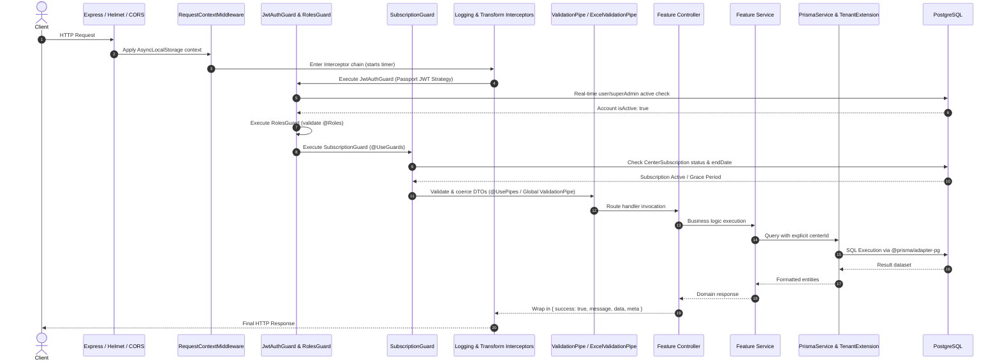

# EduCenter API — Technical Architecture & System Design

> **Document Status:** Authoritative Technical Architecture Reference  
> **Target Audience:** Backend Engineers, System Architects, DevOps, and Integration Teams  
> **Source of Truth:** Verified against Prisma Schema, NestJS 11 Core, Middleware, Guards, Interceptors, Pipes, and Module Implementations.

---

## Table of Contents

1. [High-Level Architectural Overview](#1-high-level-architectural-overview)
2. [Module Directory & Responsibilities](#2-module-directory--responsibilities)
3. [Request Lifecycle & Execution Flow](#3-request-lifecycle--execution-flow)
4. [Multi-Tenancy & Tenant Isolation Architecture](#4-multi-tenancy--tenant-isolation-architecture)
5. [Authentication & Real-Time Authorization Engine](#5-authentication--real-time-authorization-engine)
6. [Subscription Lifecycle & State Machine](#6-subscription-lifecycle--state-machine)
7. [Database Access & Transaction Integrity Patterns](#7-database-access--transaction-integrity-patterns)
8. [Unified Export & High-Performance Import Pipeline](#8-unified-export--high-performance-import-pipeline)
9. [Error Handling & Response Envelope Standard](#9-error-handling--response-envelope-standard)
10. [Infrastructure, Security & Cross-Cutting Concerns](#10-infrastructure-security--cross-cutting-concerns)

---

## 1. High-Level Architectural Overview

EduCenter is built as a **modular, domain-driven, multi-tenant B2B SaaS platform**. The architecture strictly isolates platform-level operations (managed by `SUPER_ADMIN`) from tenant-level operations (managed by educational centers and their associated `OWNER`, `TEACHER`, and `STUDENT` accounts).

```
                                      ┌────────────────────────────────┐
                                      │   Client Applications          │
                                      │  (Web, Dashboard, Parent App)  │
                                      └──────────────┬─────────────────┘
                                                     │ HTTP / JSON / Multipart
                                                     ▼
                                      ┌────────────────────────────────┐
                                      │        Express HTTP Layer      │
                                      │  (Helmet, CORS, Throttler)     │
                                      └──────────────┬─────────────────┘
                                                     │
                                                     ▼
                                      ┌────────────────────────────────┐
                                      │   RequestContextMiddleware     │
                                      │  (AsyncLocalStorage Context)   │
                                      └──────────────┬─────────────────┘
                                                     │
                         ┌───────────────────────────┴───────────────────────────┐
                         ▼                                                       ▼
            ┌───────────────────────────┐                           ┌───────────────────────────┐
            │   Platform Administration  │                           │   Tenant / Center Domain   │
            │  (SuperAdmin, Plans,      │                           │  (Grades, Subjects, Groups│
            │   Centers, Global Rev)    │                           │   Teachers, Students, Fee)│
            └─────────────┬─────────────┘                           └─────────────┬─────────────┘
                          │                                                       │
                          │                                                       ▼
                          │                                         ┌───────────────────────────┐
                          │                                         │    SubscriptionGuard      │
                          │                                         │  (Active / Grace / RO)    │
                          │                                         └─────────────┬─────────────┘
                          │                                                       │
                          └───────────────────────────┬───────────────────────────┘
                                                      │
                                                      ▼
                                      ┌────────────────────────────────┐
                                      │      Prisma Service Layer      │
                                      │  + Tenant Extension Filtering  │
                                      └──────────────┬─────────────────┘
                                                     │ pg Driver Adapter (Pool)
                                                     ▼
                                      ┌────────────────────────────────┐
                                      │   PostgreSQL 14+ Database      │
                                      └────────────────────────────────┘
```

---

## 2. Module Directory & Responsibilities

The codebase organizes domain logic into 16 decoupled NestJS feature modules:

| Module | Core Responsibility | Primary Controllers | Key Service Dependencies |
| :--- | :--- | :--- | :--- |
| `auth` | Dual login flows, session verification, OTP passwords | `AuthController` | `AuthService`, `JwtStrategy`, `UsersService` |
| `centers` | Center tenant lifecycle, onboarding transactions, renewals | `CentersController` | `CentersService`, `SubscriptionValidationService` |
| `subscription-plans` | Commercial plans, quotas, pricing, public catalog | `SubscriptionPlansController` | `SubscriptionPlansService` |
| `subscription-payments` | Platform revenue tracking, cash receipts | `SubscriptionPaymentsController`, `CenterSubscriptionPaymentsController` | `SubscriptionPaymentsService` |
| `users` | Center staff and user profiles, role-based listing | `UsersController` | `UsersService` |
| `grades` | Educational grade levels, ordering, exports/imports | `GradesController` | `GradesService`, `ExcelService`, `PdfService` |
| `subjects` | Curriculum subjects tied to grades, dropdown options | `SubjectsController` | `SubjectsService`, `ExcelService`, `PdfService` |
| `teachers` | Teacher profiles, subject capabilities, quota limits | `TeachersController` | `TeachersService`, `SubscriptionValidationService` |
| `students` | Student registry, unique center codes, enrollments | `StudentsController` | `StudentsService`, `SubscriptionValidationService` |
| `groups` | Classes, weekly recurring schedules, student rosters | `GroupsController` | `GroupsService`, `ExcelService`, `PdfService` |
| `attendance` | Attendance sessions, status recording, absence alerts | `AttendanceController` | `AttendanceService`, `NotificationsService` |
| `payments` | Monthly tuition matrices, student statement of accounts | `PaymentsController` | `PaymentsService`, `ExcelService` |
| `home-stats` | Center KPI aggregations and dashboard statistics | `HomeStatsController` | `HomeStatsService` |
| `notifications` | Internal alerts, SMS/WhatsApp dispatch logs | `NotificationsController` | `NotificationsService` |
| `audit-logs` | Immutable audit trail with IP address and metadata | `AuditLogsController` | `AuditLogsService` |
| `parent-portal` | 30-day magic tokens, public responsive student report | `ParentPortalController` | `ParentPortalService` |

---

## 3. Request Lifecycle & Execution Flow

Every HTTP request traverses a strictly ordered pipeline before reaching business logic:



---

## 4. Multi-Tenancy & Tenant Isolation Architecture

Tenant isolation is enforced across three distinct layers to ensure zero data leakage between competing learning centers:

### Layer 1: Context Propagation (`AsyncLocalStorage`)
- Implemented in `src/common/middleware/request-context.middleware.ts`.
- Captures the incoming request, IP address, user agent, and authenticated user claims.
- Stores the execution context in Node.js native `AsyncLocalStorage` (`RequestContextService`), making `centerId` accessible anywhere in the call stack without manual parameter drilling.

### Layer 2: Controller & Service Assertions
- In tenant-scoped controllers, the `@CurrentCenterId()` parameter decorator extracts `user.centerId`.
- Controllers and services assert that `centerId` is present, throwing `400 BadRequestException('المستخدم الحالي غير مرتبط بأي مركز.')` if missing.

### Layer 3: Prisma Query Scoping & Database Indexing
- Every database query and mutation explicitly specifies `where: { centerId }` or `where: { user: { centerId } }`.
- Models define composite unique constraints and tenant indices:
  - `Grade`: `@@unique([centerId, name])`, `@@index([centerId])`
  - `Subject`: `@@unique([centerId, gradeId, name])`, `@@index([centerId])`
  - `Group`: `@@unique([centerId, name])`, `@@index([centerId])`
  - `Student`: `code String @unique`, `@@index([centerId])`
  - `AttendanceSession`: `@@unique([groupId, date])`, `@@index([centerId])`
  - `MonthlyPayment`: `@@unique([groupStudentId, subscriptionDate])`, `@@index([centerId])`

---

## 5. Authentication & Real-Time Authorization Engine

```
                             POST /api/auth/login or /super-admin/login
                                                │
                                                ▼
                                    AuthService.validateUser()
                                                │
                                 ┌──────────────┴──────────────┐
                                 ▼                             ▼
                           Super Admin                   Center User
                       (SuperAdmin Table)               (User Table)
                                 │                             │
                                 ▼                             ▼
                     Generate JWT Access Token     Generate JWT Access Token
                     sub: superAdmin.id            sub: user.id
                     role: 'SUPER_ADMIN'           role: 'OWNER'|'TEACHER'|'STUDENT'
                     centerId: null                centerId: '<cuid>'
```

### 1. Real-Time Active Check in `JwtStrategy`
Unlike standard stateless JWT setups that trust an unexpired token blindly, EduCenter's `JwtStrategy.validate()` performs an active database lookup on every single request:
```typescript
// For SUPER_ADMIN:
const superAdmin = await this.prisma.superAdmin.findUnique({ where: { id: payload.sub } });
if (!superAdmin || !superAdmin.isActive) {
  throw new UnauthorizedException('تم تعطيل هذا الحساب أو لم يعد صالحاً للاستخدام.');
}

// For Center Users:
const user = await this.prisma.user.findUnique({ where: { id: payload.sub } });
if (!user || !user.isActive) {
  throw new UnauthorizedException('تم تعطيل هذا الحساب أو لم يعد صالحاً للاستخدام.');
}
```
If an administrator deactivates an account or a center is deactivated, all active sessions are revoked instantly.

### 2. Privilege Escalation Prevention
- User `role` is immutable in `UpdateUserDto`.
- Center users cannot change their `centerId` or elevate their permissions.

---

## 6. Subscription Lifecycle & State Machine

The platform enforces commercial subscription quotas and expiration through `SubscriptionGuard` and `SubscriptionValidationService`:

```
               ┌────────────────────────────────────────────────────────┐
               │              Center Provisioned (POST /centers)        │
               │         Initial Active Subscription Assigned           │
               └───────────────────────────┬────────────────────────────┘
                                           │
                                           ▼
               ┌────────────────────────────────────────────────────────┐
               │                     ACTIVE STATE                       │
               │  - Full Read & Write Access                            │
               │  - Quotas enforced: studentLimit, teacherLimit         │
               └───────────────────────────┬────────────────────────────┘
                                           │ now > subscription.endDate
                                           ▼
               ┌────────────────────────────────────────────────────────┐
               │             GRACE PERIOD (Day 1 to Day 3)              │
               │  - Full Read & Write Access continues                  │
               │  - Attached Header:                                    │
               │    X-Subscription-Warning: Grace period active.        │
               └───────────────────────────┬────────────────────────────┘
                                           │ now > (subscription.endDate + 3 days)
                                           ▼
               ┌────────────────────────────────────────────────────────┐
               │                   READ-ONLY MODE                       │
               │  - GET, HEAD, OPTIONS requests: PERMITTED              │
               │  - POST, PUT, PATCH, DELETE: BLOCKED (403 Forbidden)   │
               └───────────────────────────┬────────────────────────────┘
                                           │ Center deactivated or no active plan
                                           ▼
               ┌────────────────────────────────────────────────────────┐
               │                  INACTIVE / BLOCKED                    │
               │  - All operational requests blocked (403 Forbidden)    │
               │  - Error code: CENTER_SUBSCRIPTION_INACTIVE            │
               │  - Exempt: /auth, /subscription-plans, /centers/me     │
               └────────────────────────────────────────────────────────┘
```

### Quota Enforcements
- **Student Quota (`studentLimit`):** Validated in `StudentsService.create` and `StudentsService.importFromExcel` via `SubscriptionValidationService.validateStudentLimit(centerId)`.
- **Teacher Quota (`teacherLimit`):** Validated in `TeachersService.create` and `TeachersService.importFromExcel` via `SubscriptionValidationService.validateTeacherLimit(centerId)`.
- **Exams Feature Flag (`canCreateExams`):** Enforced before exam-related actions.
- **Curriculum Exemption:** Grades, Subjects, and Groups have **no plan limits**; they are strictly tenant-scoped to allow natural curriculum organization.

---

## 7. Database Access & Transaction Integrity Patterns

### 1. PostgreSQL Connection Pooling & Adapter
Prisma is configured using `@prisma/adapter-pg` paired with Node's `pg.Pool` (`src/database/prisma/prisma.service.ts`):
```typescript
const connectionString = process.env.DATABASE_URL;
const pool = new Pool({ connectionString });
const adapter = new PrismaPg(pool);
super({ adapter });
```

### 2. Atomic Multi-Table Transactions
For interconnected onboarding operations, Prisma interactive transactions `this.prisma.$transaction(async (tx) => { ... })` guarantee complete rollbacks on failure:
- **Center Provisioning (`CentersService.create`):**
  1. Creates `Center` record.
  2. Hashes owner password and creates `User` record (`role: OWNER`).
  3. Creates `CenterSubscription` record bound to `SubscriptionPlan`.
  4. Any duplicate slug, duplicate email, or missing plan aborts the entire transaction.

### 3. Safe Deletion & Relational Protection
Direct cascading deletes are strictly prevented on core curriculum and user entities. Deletions must inspect relational counts (`_count`) using `[entity]DetailsSelect`:
- **Grades:** Blocked if `_count.subjects > 0 || _count.groups > 0 || _count.enrollments > 0`.
- **Subjects:** Blocked if `_count.groups > 0 || _count.teacherSubjects > 0`.
- **Teachers:** Blocked if `_count.groups > 0`. On clean deletion, deletes both `Teacher` and `User` records atomically.
- **Students:** Blocked if `_count.groups > 0 || _count.attendance > 0`. On clean deletion, deletes both `Student` and `User` records atomically.
- **Groups:** Blocked if `_count.students > 0`.

---

## 8. Unified Export & High-Performance Import Pipeline

### 1. Zero-Duplication Export Architecture (DRY)
Spreadsheet (`ExcelJS`) and PDF (`PDFMake RTL`) generators share a single underlying private dataset extractor:
```
                               getExportDataset(centerId, query)
                                              │
                      ┌───────────────────────┴───────────────────────┐
                      ▼                                               ▼
             exportToExcel(centerId)                         exportToPdf(centerId)
                      │                                               │
               ExcelJS Workbook                                Cairo RTL Document
                      │                                               │
                      └───────────────────────┬───────────────────────┘
                                              │
                                     sendFileDownload()
                                  (Sets headers & streams)
```
- **Dual-Mode Calling Convention:** If `res: Response` is provided, headers (`Content-Type`, `Content-Disposition`) are set and the stream is flushed. If omitted, the raw `Buffer` is returned, facilitating clean unit testing.
- **ID Columns in Spreadsheets:** All Excel exports format entity IDs in column 1 (`numFmt: '@'`) with font `Consolas` to allow administrators to copy verified IDs with `Ctrl+C`.

### 2. High-Performance Excel Import Engine
- **File Validation:** `ExcelValidationPipe` enforces allowed MIME types (`.xlsx`, `.xls`) and maximum file size (5MB).
- **In-Memory Pre-fetching:** Reference entities (`grades`, `subjects`, `teachers`) are fetched once in bulk and indexed in a `Map<string, Entity>` to prevent $N+1$ database queries.
- **Strict ID-Based Foreign Keys:** Foreign relations require explicit IDs (e.g. `gradeId`, `subjectId`). Informational textual names are never used for foreign key lookups.
- **Atomic 422 Error Envelope:** If any row fails validation, the entire batch is rejected:
  ```json
  {
    "statusCode": 422,
    "message": "تعذر استيراد الملف لوجود أخطاء في البيانات المرفقة.",
    "error": "Unprocessable Entity",
    "data": {
      "totalRows": 10,
      "validRows": 8,
      "failedRows": 2,
      "remainingErrorsCount": 0,
      "errors": [
        { "row": 3, "field": "gradeId", "value": "invalid-id", "message": "معرف المرحلة الدراسية المدخل غير صالح أو لا ينتمي لهذا المركز أو غير نشط." }
      ]
    }
  }
  ```
- **Dry-Run Mode (`?dryRun=true`):** Runs the full validation pipeline and returns a structured preview of resolved entities without committing database writes.

---

## 9. Error Handling & Response Envelope Standard

### Unified Success Envelope
All successful responses are formatted by `TransformInterceptor`:
```json
// Single Resource:
{
  "success": true,
  "message": "تمت العملية بنجاح.",
  "data": { ... }
}

// Paginated Resource:
{
  "success": true,
  "message": "تم جلب البيانات بنجاح.",
  "data": [ ... ],
  "meta": {
    "total": 50,
    "page": 1,
    "limit": 10,
    "totalPages": 5,
    "hasNextPage": true,
    "hasPreviousPage": false
  }
}
```

### Exception Filter & Standard Error Envelopes
Managed centrally by `AllExceptionsFilter`:
```json
// Validation Error (400 Bad Request):
{
  "statusCode": 400,
  "message": ["اسم المرحلة مطلوب"],
  "error": "Bad Request"
}

// Subscription Expiration Error (403 Forbidden):
{
  "statusCode": 403,
  "message": "المركز لا يمتلك اشتراكاً نشطاً حالياً. يرجى الاشتراك في إحدى الباقات.",
  "error": "Forbidden",
  "code": "CENTER_SUBSCRIPTION_INACTIVE"
}
```

---

## 10. Infrastructure, Security & Cross-Cutting Concerns

1. **Helmet Security Headers:** Applied globally to secure against common web vulnerabilities.
2. **CORS Policy:** Whitelists local development frontends (`localhost:3000`, `localhost:5173`) and verified production domains, exposing the `X-Subscription-Warning` header.
3. **Rate Limiting (Throttler):**
   - Global default: 60 requests per minute.
   - Public auth routes (`/auth/login`, `/auth/super-admin/login`): Stricter limit of **5 requests per minute** to thwart credential brute-force attacks.
   - Password reset request (`/auth/forgot-password`): **3 requests per minute**.
4. **Audit Trail Logging:** All mutating and sensitive operations invoke `AuditLogsService.logAction(centerId, userId, action, entity, entityId, details)` capturing IP address and user agent.
